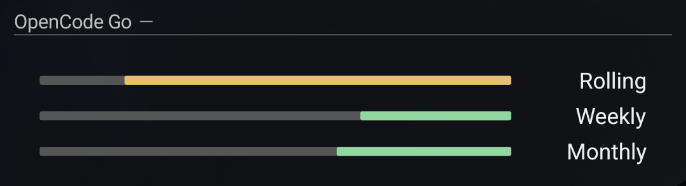

# AIO Widgets

Personal Lua widgets for AIO Launcher. Each widget follows the launcher's
handedness setting, uses aligned columns, and supports a compact home-screen view.

## Widgets

| Widget | Purpose | Minimum AIO version |
| --- | --- | --- |
| [OpenCode Go](docs/opencode-go.md) | Rolling, weekly, and monthly Go usage with reset countdowns | 7.6.0 |



## Install or update

Install Python 3, Lua 5.2 or newer, and Android platform-tools (`adb`). Connect
your phone with USB debugging enabled and authorize this computer on the phone.

```sh
python3 tools/install.py opencode-go
```

The installer validates the Lua files, checks the installed AIO version, updates
only the selected widget and any shared helpers, and verifies the copied bytes.
It preserves an existing repository-prefixed filename and refuses ambiguous
duplicates. It leaves credentials, cached usage, and other widgets alone.

On first installation, open AIO's side menu and choose **Widgets → Scripts**,
select the widget, then tap **Add widget**. Open its settings gear to configure it.

If AIO continues displaying an older version, request a launcher restart:

```sh
python3 tools/install.py opencode-go --reload
```

Use `--serial SERIAL` when multiple devices are connected. Preview the copy
commands without accessing a phone using `--dry-run`.

## Development

```sh
./tools/check.sh
LUA_BIN=luajit ./tools/check.sh
```

Checks cover Lua syntax, widget behavior with synthetic API responses, and the
installer's device/target selection safeguards. GitHub runs the checks on pushes
and pull requests. Validate layout, folding, handedness, and animation on the
actual phone before treating a visual change as finished.

```text
widgets/       Standalone .lua widgets
shared/        Reusable Lua helpers when needed
docs/          Setup guides and cropped widget screenshots
tools/         Checks and deployment tools
tests/         Deterministic checks and synthetic fixtures
```

Keep API keys and personal settings on the phone. Do not commit credentials,
launcher preference files, full phone screenshots, or account exports. The
OpenCode widget contains no embedded API key.

## References

- [AIO scripting documentation](https://github.com/zobnin/aiolauncher_scripts)
- [AIO Store](https://play.google.com/store/apps/details?id=ru.execbit.aiostore)

The test-only JSON library is [rxi/json.lua](https://github.com/rxi/json.lua);
its MIT license notice is preserved in `tests/support/json.lua`. AIO supplies the
JSON library at runtime, so no third-party library needs installing on the phone.
