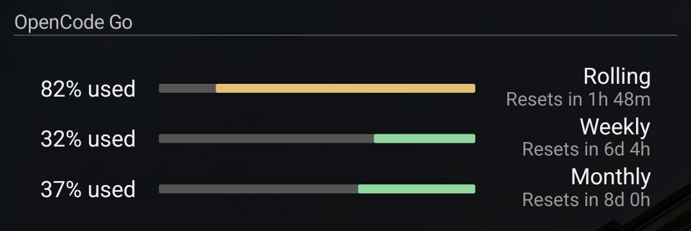

# OpenCode Go

Displays the rolling, weekly, and monthly usage windows from your OpenCode Go
account. Requires AIO Launcher **7.6.0 or newer**. Current widget version: **1.4.3**.

## Views

Tap the widget title to toggle:

- **Minimized:** three labels and aligned meters, 60dp high.
- **Expanded:** adds usage percentages and reset countdowns, 84dp high.




Both views follow AIO's handedness setting. Right-handed mode puts labels and
reset times on the right, percentages on the left, and fills bars from right to
left. Text remains readable. The content uses the launcher's full width and
balanced 14dp outer insets relative to its header divider.

The widget reserves its actual rectangular dimensions rather than forcing the
panel into a square icon. On AIO 7.6.1 and newer, it draws a PNG locally using
public Android graphics APIs and displays it with explicit width and height.
On AIO 7.6.0, it uses an intrinsically sized SVG. Unchanged panels are neither
encoded again nor rebuilt, avoiding extra work and height jumps during folding.

## Setup and controls

1. Run `python3 tools/install.py opencode-go` from the repository.
2. In AIO, choose **Widgets → Scripts → OpenCode Go → Add widget**.
3. Tap **Set API key**, or open the native settings gear and choose the key icon.
4. Paste your OpenCode Go API key from the OpenCode console.

Open the native settings gear, or long-press the widget, for:

- Refresh now.
- Open the OpenCode console.
- Change the API key.
- Toggle used/remaining percentages.
- Set the refresh interval, from 1 to 60 minutes.
- Remove the key and clear the saved usage.

In AIO's context menu, the three bottom icons are Refresh, Open console, and
Change API key. Tap the usage rows to refresh immediately.

## Refresh and saved data

Refresh defaults to every five minutes while AIO is visible. Returning to the
launcher checks an old reading. Countdown labels update every 30 seconds;
handedness changes are picked up within one second while the launcher is visible.
This script does not run a background Android service.

Failed requests retain the last successful reading and show an error in the
expanded view. Expired windows are checked again before assuming quota is
available. Meters become amber at 25% remaining and red at 10% remaining or when
the API reports a rate limit.

The API key lives in the widget's phone preferences. AIO preferences are not an
encrypted credential vault. Do not share backups containing credentials.
The saved usage file is `opencode-go-usage.json` in AIO's script-data directory.

## Usage endpoint

```text
GET https://opencode.ai/zen/go/v1/usage
Authorization: Bearer <OpenCode Go API key>
```

The response contains `usage.rolling`, `usage.weekly`, and `usage.monthly`, each
with `percent` (percentage used), `status`, and an RFC 3339 `resetsAt` timestamp.
The widget labels the monthly time as a quota reset; the endpoint does not
provide a separate billing renewal date.

## Compatibility notes

Version 1.4.3 fixes the missing widget and the long "height and width must be > 0"
error after upgrading to AIO 7.6.1. That build passes the automatic icon size
(-1) to its SVG rasterizer as a negative image dimension. The PNG image path
avoids that renderer and retains the 60dp/84dp folding geometry. Invalid display
metrics also fall back to positive dimensions. Updating the script preserves
the existing API key, preferences, and saved usage.

Handedness is read from AIO's `for_right_handed` preference. Image sizing uses
the display density, and the divider-width calculation allows for AIO's two
8dp outer gutters. The original SVG path was verified with AIO 7.6.0; the PNG
path was verified with AIO 7.6.1 on the connected Samsung phone. Recheck these
integrations when upgrading AIO or changing its layout.
